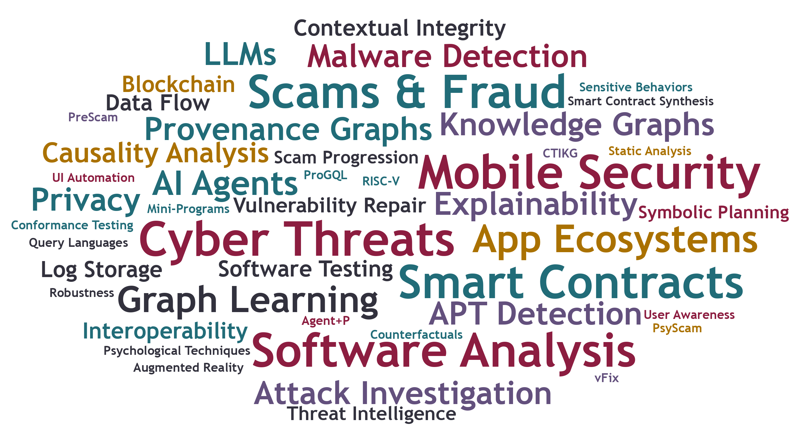
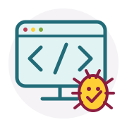
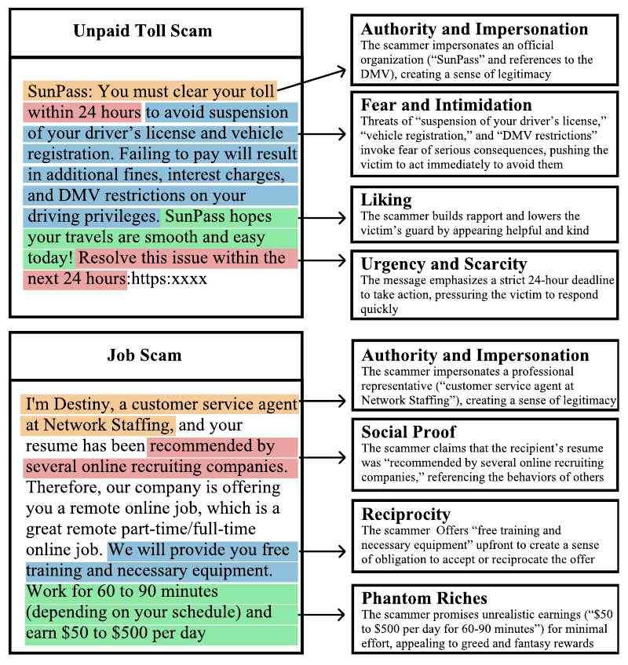
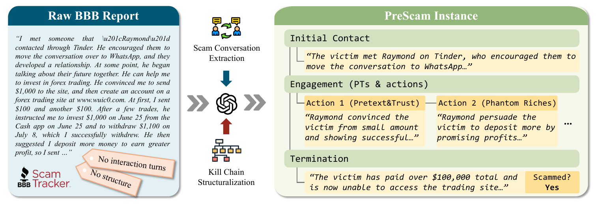
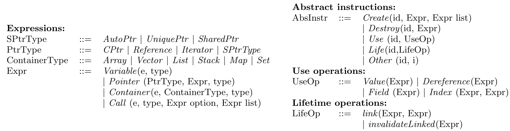





<figure class="publication-wordcloud">
  

    
    
    
    
    
    
  

  <figcaption><strong>Recent publications &amp; five research directions</strong> Explore a research direction through its character.</figcaption>
</figure>

##  Cyber Threat Detection and Investigation {#cyber-threat-detection-and-investigation}

Stealthy, multi-stage attacks hide malicious actions among vast amounts of ordinary system activity. RISE lab develops **scalable detection and investigation techniques that connect evidence and reconstruct attacks**. We use system audit logs and provenance graphs to connect processes, files, and network activity. Our research addresses four complementary challenges:

1. **Efficient storage and effective querying of log data.** We reduce audit data while preserving dependencies needed for investigation ([CCS'16](https://xusheng-xiao.github.io/papers/reduction-ccs.pdf), [CCS'18](https://xusheng-xiao.github.io/papers/nodemerge-ccs2018.pdf)), mine behavior patterns to assist query construction ([VLDB'16](https://xusheng-xiao.github.io/papers/p240-zong.pdf)), and design domain-specific languages and optimized engines for attack queries, streaming anomalies, and extensible provenance searches ([USENIX ATC'18](https://xusheng-xiao.github.io/papers/aiql-usenix_atc2018.pdf), [USENIX Security'18](https://xusheng-xiao.github.io/papers/saql-usenixsecurity2018.pdf), [ICDE'26](https://xusheng-xiao.github.io/papers/progql_icde2026.pdf)).
2. **Causality analysis for attack reconstruction.** To make large dependency graphs interpretable, we support responsive, analyst-guided backtracking ([ICDE'20](https://xusheng-xiao.github.io/papers/aptrace-camera-ready.pdf)), summarize cooperating processes into communities with DepComm ([IEEE S&P'22](https://xusheng-xiao.github.io/papers/depcomm-ieeesp2022.pdf)), and use DepImpact to rank attack entry points and isolate critical attack sequences ([USENIX Security'22](https://xusheng-xiao.github.io/papers/sec22summer_fang.pdf)).
3. **Accurate and deployable APT detection.** We combine distributed host-level detection and global models to reduce deployment costs and false alarms ([USENIX Security'23](https://xusheng-xiao.github.io/papers/usenixsecurity23-distdet.pdf)), and recover concise attack graphs during online detection ([NDSS'24](https://xusheng-xiao.github.io/papers/nodlink-ndss.pdf)). Industrial studies identify the practical constraints on detection overhead, alert triage, and interpretation ([CCS'23](https://xusheng-xiao.github.io/papers/provenance_study_ccs_2023.pdf)).
4. **Integrating cyber threat intelligence (CTI).** We translate threat reports into structured behaviors and executable hunting queries ([ICDE'21](https://xusheng-xiao.github.io/papers/threatraptor-icde21_0.pdf)). We further use LLMs with coordinated agents and memory to build security knowledge graphs from CTI articles, connecting threat knowledge across reports ([COLM'24](https://xusheng-xiao.github.io/papers/ctikg-colm2024.pdf)). To improve security knowledge graph construction, we build training supervision from article–graph alignments and train compact LLM extractors with reusable, task-specific rewards ([arXiv'26](https://arxiv.org/abs/2605.16714)). Complementing graph construction, we align combinations of observed system events with CTI attack steps to produce evidence-grounded attack investigation reports ([arXiv'26](https://arxiv.org/abs/2611.29932)).

We also benchmark the misuse of command line agents on security tasks and end-to-end attack chains to understand emerging AI-enabled threats ([EMNLP'26](https://aclanthology.org/2026.findings-emnlp.491/)).

* Our cyber threat investigation research received the ***[Samsung GRO Award](https://www.sait.samsung.co.kr/saithome/about/collabo_overview.do)***.
* Our attack investigation research was a finalist for the ***[CSAW Best Applied Security Paper Award 2018](https://csaw.engineering.nyu.edu/)***. The security intelligence solution built by our team won first place in the ***[Town Life and Society Innovation Category at CEATEC](http://www.ceatec.com/en/award/award01_02.html)***. Project websites: [AIQL](https://sites.google.com/site/aiqlsystem/) and [SAQL](https://sites.google.com/site/saqlsystem/).
* Open-source projects: [ProGQL](/software/#progql) ([code](https://github.com/ProGQL/ProGQL)), [CTIKG](/software/#ctikg) ([code](https://github.com/ctikgresearch/GTIKGResearch)), [DepComm](/software/#depcomm) ([code](https://github.com/ieeesp2021sub/depcomm)), and [DepImpact](/software/#depimpact) ([code](https://github.com/usenixsub/DepImpact)).

**NSF awards**

* [NSF #2613277](https://www.nsf.gov/awardsearch/show-award?AWD_ID=2613277): CICI: TCR: Cyber Threat Triage and Investigation for Scientific Institutions via Adaptive Deployable Provenance Analysis and Agentic AI-Based Threat Intelligence.
* [NSF #2438197](https://www.nsf.gov/awardsearch/show-award?AWD_ID=2438197): SaTC: CORE: Small: Scalable Cyber Attack Investigation using Declarative Queries and Interrogative Analysis.

##  Online Scam/Fraud and Cyber Deception {#online-scam-fraud-and-cyber-deception}

<figure style="min-width:0; margin:0; display:block;">
  
  <figcaption>Psychological techniques in real-world scams (<a href="https://xusheng-xiao.github.io/papers/psyscam_emnlp_2025.pdf">EMNLP'25</a>).</figcaption>
</figure>
<figure style="min-width:0; margin:0; display:block;">
  
  <figcaption>Modeling scam conversations and progression (<a href="https://xusheng-xiao.github.io/papers/prescam_colm2026.pdf">COLM'26</a>).</figcaption>
</figure>

Online fraud exploits both human trust and weaknesses in digital platforms. Scam messages evolve, persuasive tactics shift across conversations, and fraudulent assets can resemble legitimate investments. RISE lab aims to **recognize the mechanisms of deception and track risk as scams unfold**, combining psychological theory, language modeling, and transaction analysis across four directions:

1. **Understanding psychological manipulation.** We ground annotations of real-world scam reports in cognitive and psychological theories, creating a benchmark for identifying persuasive techniques and evaluating how language models complete and generate scam variants. This reveals weaknesses that surface-level scam classification can miss ([EMNLP'25](https://xusheng-xiao.github.io/papers/psyscam_emnlp_2025.pdf)).
2. **Modeling scam progression.** We structure victim-submitted reports into multi-turn conversations organized by a scam lifecycle, with annotations of scammer actions and victim responses. We evaluate whether models can estimate proximity to a scam's termination stage and predict the scammer's next actions, exposing the gap between fluent language generation and understanding escalating risk ([COLM'26](https://xusheng-xiao.github.io/papers/prescam_colm2026.pdf)).
3. **Detecting scam scenarios and characterizing campaigns.** We derive a hierarchical taxonomy of recurring scam scenarios from incident reports and analyze their psychological techniques, operational goals, and reused infrastructure. We transfer this scenario-level knowledge to conversation-aware detection in financial-institution customer interactions, supporting timely warnings and intervention ([arXiv'26](https://arxiv.org/abs/2606.16052)).
4. **Detecting fraud in decentralized markets.** We combine transaction analysis, relationships among accounts, and machine learning to identify scam tokens and characterize rug pulls, colluding addresses, and victim exposure on decentralized exchanges ([SIGMETRICS'22](https://xusheng-xiao.github.io/papers/uniswap.pdf)).

* Open-source project and dataset: [PsyScam](/software/#psyscam) ([code](https://github.com/KiteFlyKid/PsyScam)), with additional materials at [Open Science](https://anonymous.4open.science/r/PsyScam-66E4/README.md).

##  Mobile App Analysis {#mobile-app-analysis}

Mobile apps can access sensitive data for legitimate functionality or abuse the same capabilities in ways users do not expect. Permissions alone reveal little about the purpose of an action, and newer app ecosystems introduce additional privacy risks. RISE lab combines program analysis with language, vision, and learning techniques to **determine whether app behavior is justified, explain data use, and uncover abuse at scale**. Our research spans four directions:

1. **Connecting behavior with user expectations.** We infer intended functionality from app descriptions, UI text, icons, and the contexts that trigger sensitive actions, then identify behavior that does not fit those intentions ([USENIX Security'13](https://xusheng-xiao.github.io/papers/whyper-usenix2013.pdf), [ICSE'15](https://xusheng-xiao.github.io/papers/appcontext-icse2015.pdf), [ICSE'19](https://xusheng-xiao.github.io/papers/iconintent-icse2019.pdf), [CCS'19](https://xusheng-xiao.github.io/papers/deepintent-optimize.pdf)).
2. **Explaining sensitive data use.** We connect code semantics, UI context, and privacy policies to synthesize app-specific explanations of why sensitive data is used. Our approaches range from context-aware neural translation to LLMs supported by program structure and knowledge from similar apps ([ICSE'22](https://xusheng-xiao.github.io/papers/describectx_cr.pdf), [ASE'25](https://xusheng-xiao.github.io/papers/appbds-ase2025.pdf)).
3. **Detecting abuse across the app ecosystem.** We use user feedback to identify policy violations ([ICSE'21](https://xusheng-xiao.github.io/papers/champ_icse2021_cr-submit3.pdf)), estimate prediction uncertainty to improve malware detection ([ICSE'24](https://xusheng-xiao.github.io/papers/uncertainty_icse_cr.pdf)), and combine UI exploration with graph learning to detect and explain malware distribution through app promotion ads ([NDSS'25](https://xusheng-xiao.github.io/papers/adgpe_ndss2025.pdf)).
4. **Auditing overlooked sources of private data.** We identify sensitive user inputs in app interfaces ([USENIX Security'15](https://xusheng-xiao.github.io/papers/supor-usenix2015.pdf)), trace information leaks in mini-programs ([ASE'23](https://xusheng-xiao.github.io/papers/wemint-ase2023.pdf)), and analyze augmented reality apps for undisclosed data access and violations of least privilege ([ASE'26](https://xusheng-xiao.github.io/papers/ar_study_ase2026.pdf)).

* 🏆 Our Android AR privacy study ([ASE'26](https://xusheng-xiao.github.io/papers/ar_study_ase2026.pdf)) received the **ACM SIGSOFT Distinguished Paper Award**.
* Our mobile security research was a finalist for the ***[CSAW Best Applied Security Paper Award 2015](https://csaw.engineering.nyu.edu/)***. Our work on user-aware information-flow control ([ASE'12](https://xusheng-xiao.github.io/papers/xusheng-ase2012.pdf)) was deployed in Microsoft Research's TouchDevelop.
* Open-source projects: [DeepIntent](/software/#deepintent) ([code](https://github.com/deepintent-ccs/DeepIntent/)), [AppBDS](/software/#appbds) ([code](https://github.com/AppBDS/AppBDS)), [AdGPE](/software/#adgpe) ([code](https://github.com/AppPromotionAdsResearch/AdGPE)), [DescribeCtx](/software/#describectx) ([code](https://github.com/DescribeCTX/DescribeCTX)), [ProMal](/software/#promal) ([code](https://github.com/promal-android/Promal)), and [CHAMP / UBCFinder](/software/#champ) ([code](https://github.com/UBCFinder/UBCFinder)), [AppContext](/software/#appcontext), and [WHYPER](/software/#whyper).
* Related tools and project websites: [AppContext](/software/#appcontext) ([code](https://sites.google.com/site/asergrp/projects/appcontext)) and [WHYPER](/software/#whyper) ([code](https://sites.google.com/site/whypermission/)).

**NSF awards**

* [NSF #2318483](https://www.nsf.gov/awardsearch/show-award?AWD_ID=2318483): CAREER: Enhancing Mobile Application Security through Contextual Integrity and User Awareness.
* [NSF #2318486](https://www.nsf.gov/awardsearch/show-award?AWD_ID=2318486): Collaborative Research: EAGER: Enhancing Security and Privacy of Augmented Reality Mobile Applications through Software Behavior Analysis.
* [NSF #1755772](https://www.nsf.gov/awardsearch/show-award?AWD_ID=1755772): CRII: SaTC: Enhancing Mobile App Security by Detecting Icon-Behavior Contradiction.

##  Blockchain and Smart Contract {#blockchain-and-smart-contract}

<figure style="max-width:850px; margin:1.5em 0;">
  
  <figcaption>Automated smart contract vulnerability repair (<a href="https://xusheng-xiao.github.io/papers/vFix_ICSME2024.pdf">ICSME'24</a>).</figcaption>
</figure>

Blockchain applications must coordinate across isolated networks, faithfully implement agreements, and protect assets despite vulnerabilities and fraud. RISE lab works toward **programmable, correct, and secure decentralized applications** through complementary techniques for their infrastructure, implementation, maintenance, and use:

1. **Secure cross-blockchain composition.** We provide a unified programming model for applications spanning heterogeneous blockchains, paired with a cryptographic protocol that securely coordinates their execution. This extends interoperability beyond token exchange to programmable cross-chain applications ([CCS'19](https://xusheng-xiao.github.io/papers/hyperservice.pdf), [IEEE TDSC'22](https://xusheng-xiao.github.io/papers/hyperservice-tdsc21.pdf)).
2. **Translating agreements into executable contracts.** We combine natural language analysis with an intermediate representation to synthesize smart contracts from financial legal agreements. Template-based generation and validation help preserve agreement semantics and check the resulting code for known vulnerabilities ([ISSTA'23](https://xusheng-xiao.github.io/papers/iSyn_issta.pdf)).
3. **Repairing vulnerable smart contracts.** We combine multiple static verification tools, reusable fix patterns, and dependency and pointer analyses to generate security patches. Verification of the patched contract checks that targeted vulnerabilities have been removed while evaluations assess preservation of expected behavior ([ICSME'24](https://xusheng-xiao.github.io/papers/vFix_ICSME2024.pdf)).
4. **Understanding abuse of decentralized finance.** We analyze trading activity and account relationships to identify fraudulent tokens and characterize rug-pull mechanisms, complementing code-level security with evidence about how contracts are used in real markets ([SIGMETRICS'22](https://xusheng-xiao.github.io/papers/uniswap.pdf)).

* Open-source projects: [HyperService](/software/#hyperservice) ([code](https://github.com/HyperService-Consortium)), [iSyn](/software/#isyn) ([code](https://github.com/smartcontractsyn/iSyn)), and [vFix](/software/#vfix) ([code](https://github.com/vfixresearch/vFix)).

##  Software Testing and Program Analysis {#software-testing-and-program-analysis}

<figure style="min-width:0; margin:0; display:block;">
  
  <figcaption>Program representation for ownership and lifetime analysis (<a href="https://xusheng-xiao.github.io/papers/cilppa-issta2014.pdf">ISSTA'14</a>).</figcaption>
</figure>
<figure style="min-width:0; margin:0; display:block;">
  
  <figcaption>Abstraction of C++ behavior for static analysis (<a href="https://xusheng-xiao.github.io/papers/cilppa-issta2014.pdf">ISSTA'14</a>).</figcaption>
</figure>

Software failures arise when implementations, specifications, and actual execution conditions diverge. Complex language semantics, incomplete tests, evolving interfaces, and workload-dependent behavior make these gaps difficult to detect manually. RISE lab develops **automated analysis techniques that expose these gaps and guide reliable development and execution**, organized into six complementary approaches:

1. **Improving test generation and debugging.** We diagnose dependencies that prevent automated tests from reaching uncovered code ([ICSE'11](https://xusheng-xiao.github.io/papers/covana-icse2011.pdf)), study loop-related limits of symbolic execution ([ASE'13](https://xusheng-xiao.github.io/papers/xusheng-ase2013.pdf)), and infer concise preconditions from failing tests ([DSN'18](https://xusheng-xiao.github.io/papers/dsn18-preinfer.pdf)). Configurable mutation analysis further helps assess Android test suites ([ICSE'20](https://xusheng-xiao.github.io/papers/icse_tooldemo_2020_droidmutator_1.pdf)).
2. **Checking semantic correctness.** We model C++ objects, pointers, containers, and lifetime dependencies to detect typestate and lifetime errors ([ISSTA'14](https://xusheng-xiao.github.io/papers/cilppa-issta2014.pdf)). We also study specification-guided detection of ISA conformance bugs in RISC-V emulators ([ICSE'27](/publications/#2027)).
3. **Guiding LLM-assisted vulnerability repair.** Passing functional tests does not establish that a patch restores the security requirement violated by a vulnerability. We mine recurring fix patterns from security patches, map these patterns to security impact classes, and use these associations to select relevant repair examples for LLMs. This connects vulnerability characterization with patch generation and improves repair over zero-shot prompting and random example selection ([arXiv'26](https://arxiv.org/abs/2611.31993v1)).
4. **Recovering specifications from natural language.** We extract formal API contracts and access-control rules from documentation and requirements, making otherwise informal constraints available for automated checking ([ICSE'12](https://xusheng-xiao.github.io/papers/xusheng-icse2012.pdf), [FSE'12](https://xusheng-xiao.github.io/papers/text2policy-fse2012.pdf), [ACSAC'14](https://xusheng-xiao.github.io/papers/xusheng-acsac2014.pdf)).
5. **Making UI-driven automation reliable.** We generate reproducible mobile tests, build precise UI transition models, and distinguish meaningful web-interface changes from content updates ([HotMobile'19](https://xusheng-xiao.github.io/papers/hotm068-maa.pdf), [ICSE'22](https://xusheng-xiao.github.io/papers/promal_icse_cr.pdf), [ISSTA'21](https://xusheng-xiao.github.io/papers/webevo-cr.pdf)). Symbolic planning over UI transition graphs also guides LLM agents through long tasks and reduces redundant exploration ([AACL-IJCNLP'26](https://xusheng-xiao.github.io/papers/agent_p_aacl2026.pdf)).
6. **Understanding performance and resource use.** We infer how expensive operations scale with workload to expose performance bottlenecks ([ISSTA'13](https://xusheng-xiao.github.io/papers/deltainfer-issta2013.pdf)), and identify execution phases to adapt CPU frequency while respecting latency requirements ([RTAS'19](https://xusheng-xiao.github.io/papers/rtas2019-final29.pdf)).

* Our software testing research received ***[ICSE SRC Best Project Representing an Innovative Use of Microsoft Technology](https://www.csc.ncsu.edu/news/1347)*** at the [ACM SRC Grand Final 2012](https://src.acm.org/grand-finalists/2012).
* Open-source projects: [API Specification Inference](/software/#apiinfer), [Covana](/software/#covana), [WebEvo](/software/#webevo) ([code](https://github.com/webevoexp/webevo)), [DroidMutator](https://github.com/SQS-JLiu/DroidMutator), and [Agent+P](https://github.com/KiteFlyKid/agentp).
* Related tools and project websites: [APIInfer](https://research.csc.ncsu.edu/ase/projects/pint/) and [Covana](/software/#covana) ([code](http://pexase.codeplex.com/wikipage?title=Covana&referringTitle=Home)).
