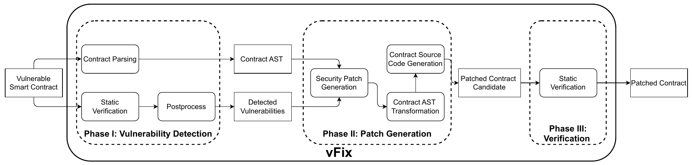
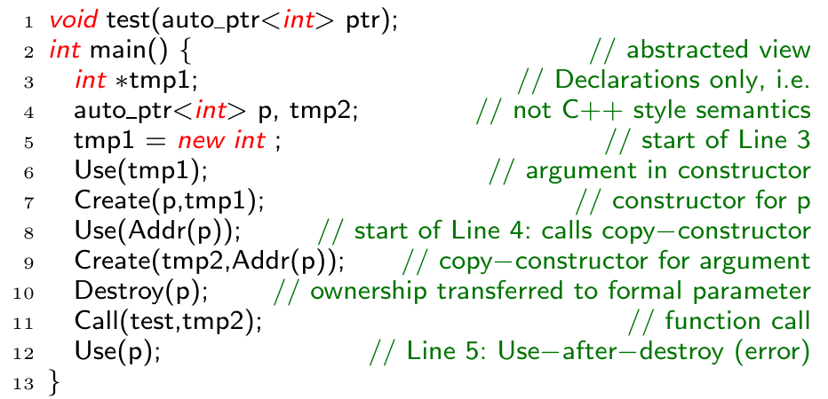



## Cyber Threat Detection and Investigation {#cyber-threat-detection-and-investigation}

RISE lab developes system security techniques that **monitors software behaviors using system auditing** and **model the causality among software behaviors** to provide contextual information of cyber threats, assisting cyber threat investigation. Specifically, to address the fundamental limitations of causality analysis in system auditing, we have develop data reduction techniques, attack behavior query and detection techniques with domain-specific language support, and causality analysis techniques to analyze system auditing logs. 
* Our work in attack investigation was selected as one of the top ten finalists for ***[CSAW Best Applied Security Paper Award 2018](https://csaw.engineering.nyu.edu/)***. 
* The security intelligence solution built by our team won first place in the ***[Town Life and Society Innovation Category at CEATEC Award](http://www.ceatec.com/en/award/award01_02.html)***. Check out our project websites at [AIQL](https://sites.google.com/site/aiqlsystem/), [SAQL](https://sites.google.com/site/saqlsystem/). 
* See our papers at [VLDB'16](https://engineering.case.edu/groups/xusheng-xiao/sites/engineering.case.edu.groups.xusheng-xiao/files/docs/behaviorquery-vldb2016.pdf), [CCS'16](https://engineering.case.edu/groups/xusheng-xiao/sites/engineering.case.edu.groups.xusheng-xiao/files/docs/reduction-ccs.pdf), [USENIX ATC'18](https://engineering.case.edu/groups/xusheng-xiao/sites/engineering.case.edu.groups.xusheng-xiao/files/docs/aiql-usenix_atc2018_0.pdf), [USENIX Security'18](https://engineering.case.edu/groups/xusheng-xiao/sites/engineering.case.edu.groups.xusheng-xiao/files/docs/sec18-final146.pdf), [CCS' 18](http://engineering.case.edu/groups/xusheng-xiao/sites/engineering.case.edu.groups.xusheng-xiao/files/docs/nodemerge-ccs2018.pdf), [ICDE'20](https://engineering.case.edu/groups/xusheng-xiao/sites/engineering.case.edu.groups.xusheng-xiao/files/docs/aptrace-camera-ready.pdf), [ICDE'21](https://engineering.case.edu/groups/xusheng-xiao/sites/engineering.case.edu.groups.xusheng-xiao/files/docs/threatraptor-icde21_0.pdf), [USENIX Security'22](https://engineering.case.edu/groups/xusheng-xiao/sites/engineering.case.edu.groups.xusheng-xiao/files/docs/sec22summer_fang.pdf), [IEEE S&P'22](https://engineering.case.edu/groups/xusheng-xiao/sites/engineering.case.edu.groups.xusheng-xiao/files/docs/depcomm-ieeesp2022.pdf).

* Our recent work advances **scalable, intelligence-guided cyber threat investigation** through provenance graph queries ([ICDE'26](https://xusheng-xiao.github.io/papers/progql_icde2026.pdf)), LLM-powered threat intelligence extraction ([COLM'24](https://xusheng-xiao.github.io/papers/ctikg-colm2024.pdf)), and fine-grained attack detection ([NDSS'24](https://xusheng-xiao.github.io/papers/nodlink-ndss.pdf)). We also study the industrial deployment of provenance-based detection and response ([CCS'23](https://xusheng-xiao.github.io/papers/provenance_study_ccs_2023.pdf)) and develop cost-effective distributed threat detection ([USENIX Security'23](https://xusheng-xiao.github.io/papers/usenixsecurity23-distdet.pdf)). We further study security evaluation of command line agents ([EMNLP'26](/publications/#2026)).

**NSF awards**

* [NSF #2613277](https://www.nsf.gov/awardsearch/show-award?AWD_ID=2613277): CICI: TCR: Cyber Threat Triage and Investigation for Scientific Institutions via Adaptive Deployable Provenance Analysis and Agentic AI-Based Threat Intelligence.
* [NSF #2438197](https://www.nsf.gov/awardsearch/show-award?AWD_ID=2438197): SaTC: CORE: Small: Scalable Cyber Attack Investigation using Declarative Queries and Interrogative Analysis.

## Online Scam/Fraud and Cyber Deception {#online-scam-fraud-and-cyber-deception}

<figure style="max-width:650px; margin:1.5em 0;">
  
  <figcaption>Psychological techniques in real-world scams (<a href="https://xusheng-xiao.github.io/papers/psyscam_emnlp_2025.pdf">EMNLP'25</a>).</figcaption>
</figure>

<figure style="max-width:850px; margin:1.5em 0;">
  
  <figcaption>Modeling scam conversations and progression (<a href="https://xusheng-xiao.github.io/papers/prescam_colm2026.pdf">COLM'26</a>).</figcaption>
</figure>

RISE lab develops AI-driven techniques to **detect and understand online scams, fraud, and cyber deception**. We combine large language models with insights from psychology to analyze how scammers manipulate victims and how deceptive interactions evolve over time. Specifically, we develop benchmarks for identifying psychological techniques in real-world scams and predicting scam progression from early conversations. We also study cryptocurrency fraud by detecting and characterizing scam tokens on decentralized exchanges.

* Our recent work studies **psychological manipulation and scam progression** by benchmarking the techniques used in real-world scams ([EMNLP'25](https://xusheng-xiao.github.io/papers/psyscam_emnlp_2025.pdf)) and predicting how risk and scammers' actions evolve across conversations ([COLM'26](https://xusheng-xiao.github.io/papers/prescam_colm2026.pdf)). We also combine transaction analysis and machine learning to detect cryptocurrency scams on decentralized exchanges ([SIGMETRICS'22](https://xusheng-xiao.github.io/papers/uniswap.pdf)).

## Mobile App Analysis {#mobile-app-analysis}

RISE lab combines program analysis and machine learning techniques to model both **program semantics** and **behavior intention** for detecting *undesired software behaviors* that cannot be justified by software applications' functionality. Specifically, we have developed a series of techniques to improve mobile app security. First, we combined program analysis techniques, computer vision techniques, and text analysis techniques to analyze the images and the text in the GUIs of mobile apps to understand behavior intention of mobile apps. Second, we combine program analysis techniques and machine learning techniques to train a model using a large number of apps, and use the model to detect undesired behaviors that cannot be justified by apps’ functionality. Also, existing techniques only tell the users what private data the apps want to use, but do not explain why the apps use users’ private data. Third, to address this problem, we combine program analysis techniques and machine learning techniques to train a model that can synthesize natural-language descriptions to describe the program behaviors that use users’ private data, which can be used to explain why the apps use users’ private data. 
* Our work in mobile security was selected as one of the top ten finalists for ***[CSAW Best Applied Security Paper Award 2015](https://csaw.engineering.nyu.edu/)***, and produced a static analysis tool that was deployed in TouchDevelop of Microsoft Research.  
* Check out our open sourced tools for AppContext, WHYPER. See our papers at [ASE'12](https://engineering.case.edu/groups/xusheng-xiao/sites/engineering.case.edu.groups.xusheng-xiao/files/docs/xusheng-ase2012.pdf), [USENIX Security'13](https://engineering.case.edu/groups/xusheng-xiao/sites/engineering.case.edu.groups.xusheng-xiao/files/docs/whyper-usenix2013.pdf), [ICSE'15](https://engineering.case.edu/groups/xusheng-xiao/sites/engineering.case.edu.groups.xusheng-xiao/files/docs/appcontext-icse2015_0.pdf), [ASEJ'15](https://link.springer.com/article/10.1007/s10515-014-0166-y), [USENIX Security'15](https://engineering.case.edu/groups/xusheng-xiao/sites/engineering.case.edu.groups.xusheng-xiao/files/docs/supor-usenix2015.pdf), [ICSE’19](https://engineering.case.edu/groups/xusheng-xiao/sites/engineering.case.edu.groups.xusheng-xiao/files/docs/iconintent-icse2019.pdf), [CCS'19](https://engineering.case.edu/groups/xusheng-xiao/sites/engineering.case.edu.groups.xusheng-xiao/files/docs/deepintent-optimize.pdf), [ICSE'21](https://engineering.case.edu/groups/xusheng-xiao/sites/engineering.case.edu.groups.xusheng-xiao/files/docs/champ_icse2021_cr-submit3.pdf), [ICSE'22-a](https://engineering.case.edu/groups/xusheng-xiao/sites/engineering.case.edu.groups.xusheng-xiao/files/docs/describectx_cr.pdf), [ICSE'22-b](https://engineering.case.edu/groups/xusheng-xiao/sites/engineering.case.edu.groups.xusheng-xiao/files/docs/promal_icse_cr.pdf). 
* The recent work DeepIntent (CCS'19) that detects intention-behavior discrepancies using the synergy of program analysis and deep learning releases the code and the complete dataset (including example dataset) at [Github](https://github.com/deepintent-ccs/DeepIntent/).

* Our recent work strengthens **mobile privacy analysis and behavior understanding** through LLM-powered descriptions of sensitive behaviors ([ASE'25](https://xusheng-xiao.github.io/papers/appbds-ase2025.pdf)), detection and explanation of malware promotion ([NDSS'25](https://xusheng-xiao.github.io/papers/adgpe_ndss2025.pdf)), uncertainty-aware malware detection ([ICSE'24](https://xusheng-xiao.github.io/papers/uncertainty_icse_cr.pdf)), and sensitive data leak analysis in mini-programs ([ASE'23](https://xusheng-xiao.github.io/papers/wemint-ase2023.pdf)).
* 🏆 Our study of **security and privacy risks in Android augmented reality apps** ([ASE'26](https://xusheng-xiao.github.io/papers/ar_study_ase2026.pdf)) received the **ACM SIGSOFT Distinguished Paper Award**.

**NSF awards**

* [NSF #2318483](https://www.nsf.gov/awardsearch/show-award?AWD_ID=2318483): CAREER: Enhancing Mobile Application Security through Contextual Integrity and User Awareness.
* [NSF #2318486](https://www.nsf.gov/awardsearch/show-award?AWD_ID=2318486): Collaborative Research: EAGER: Enhancing Security and Privacy of Augmented Reality Mobile Applications through Software Behavior Analysis.
* [NSF #1755772](https://www.nsf.gov/awardsearch/show-award?AWD_ID=1755772): CRII: SaTC: Enhancing Mobile App Security by Detecting Icon-Behavior Contradiction.

## Blockchain and Smart Contract {#blockchain-and-smart-contract}

<figure style="max-width:850px; margin:1.5em 0;">
  
  <figcaption>Automated smart contract vulnerability repair (<a href="https://xusheng-xiao.github.io/papers/vFix_ICSME2024.pdf">ICSME'24</a>).</figcaption>
</figure>

RISE lab develops software analysis and system analysis techniques for blockchain systems and smart contracts. Specifically, we have developed Hyper Service ([CCS' 19](https://engineering.case.edu/groups/xusheng-xiao/sites/engineering.case.edu.groups.xusheng-xiao/files/docs/hyperservice.pdf)), the ***first interoperability blockchain platform with programmability and strong security guarantees***. 
* It is open sourced at [Github](https://github.com/HyperService-Consortium). 
* Our recent work also studies digital asset trading platforms ([SIGMETRICS'22](https://engineering.case.edu/groups/xusheng-xiao/sites/engineering.case.edu.groups.xusheng-xiao/files/docs/uniswap.pdf)).

* Our recent work advances **secure and programmable blockchain systems** through automated vulnerability repair ([ICSME'24](https://xusheng-xiao.github.io/papers/vFix_ICSME2024.pdf)), smart contract synthesis from legal financial agreements ([ISSTA'23](https://xusheng-xiao.github.io/papers/iSyn_issta.pdf)), and cross-blockchain interoperability and programmability ([IEEE TDSC'22](https://xusheng-xiao.github.io/papers/hyperservice-tdsc21.pdf)). We also investigate fraud in decentralized trading platforms ([SIGMETRICS'22](https://xusheng-xiao.github.io/papers/uniswap.pdf)).

## Software Testing and Program Analysis {#software-testing-and-program-analysis}

<figure style="max-width:650px; margin:1.5em 0;">
  
  <figcaption>Program representation for ownership and lifetime analysis (<a href="https://xusheng-xiao.github.io/papers/cilppa-issta2014.pdf">ISSTA'14</a>).</figcaption>
</figure>

<figure style="max-width:850px; margin:1.5em 0;">
  
  <figcaption>Abstraction of C++ behavior for static analysis (<a href="https://xusheng-xiao.github.io/papers/cilppa-issta2014.pdf">ISSTA'14</a>).</figcaption>
</figure>

RISE lab develops static program analysis techniques and dynamic symbolic execution techniques to improve software testing ([ICSE'2011](https://engineering.case.edu/groups/xusheng-xiao/sites/engineering.case.edu.groups.xusheng-xiao/files/docs/covana-icse2011.pdf), [ASE'13](https://engineering.case.edu/groups/xusheng-xiao/sites/engineering.case.edu.groups.xusheng-xiao/files/docs/xusheng-ase2013.pdf), [ICSE'16 Edu](https://engineering.case.edu/groups/xusheng-xiao/sites/engineering.case.edu.groups.xusheng-xiao/files/docs/icse16seet-similarity.pdf), [DSN'18](https://engineering.case.edu/groups/xusheng-xiao/sites/engineering.case.edu.groups.xusheng-xiao/files/docs/dsn18-preinfer.pdf), [HotMobile' 19](http://engineering.case.edu/groups/xusheng-xiao/sites/engineering.case.edu.groups.xusheng-xiao/files/docs/hotm068-maa.pdf)), bug detection ([ISSTA'14](https://xusheng-xiao.github.io/papers/cilppa-issta2014.pdf), [FSE Demo'17](https://engineering.case.edu/groups/xusheng-xiao/sites/engineering.case.edu.groups.xusheng-xiao/files/docs/fse17demo.pdf)), and software performance ([ISSTA'13](https://engineering.case.edu/groups/xusheng-xiao/sites/engineering.case.edu.groups.xusheng-xiao/files/docs/deltainfer-issta2013.pdf), [RTAS'19](http://engineering.case.edu/groups/xusheng-xiao/sites/engineering.case.edu.groups.xusheng-xiao/files/docs/rtas2019-final29.pdf)). Our lab also develops text analysis techniques to improve access control policy extraction ([FSE'12](https://engineering.case.edu/groups/xusheng-xiao/sites/engineering.case.edu.groups.xusheng-xiao/files/docs/text2policy-fse2012.pdf), [ACSAC'14](https://engineering.case.edu/groups/xusheng-xiao/sites/engineering.case.edu.groups.xusheng-xiao/files/docs/xusheng-acsac2014.pdf)) and precondition extraction from API documents ([ICSE'12](https://engineering.case.edu/groups/xusheng-xiao/sites/engineering.case.edu.groups.xusheng-xiao/files/docs/xusheng-icse2012.pdf)).
* Our work in software testing received ***[ICSE SRC Best Project Representing an Innovative Use of Microsoft Technology](https://www.csc.ncsu.edu/news/1347)*** at [ACM SRC Grand Final 2012](https://src.acm.org/grand-finalists/2012). 
* Check out the open sourced tools for [Covana](http://pexase.codeplex.com/wikipage?title=Covana&referringTitle=Home), [APIInfer](https://research.csc.ncsu.edu/ase/projects/pint/).

* Our recent work improves **software reliability and AI agent assurance** through specification-guided conformance testing of RISC-V emulators ([ICSE'27](/publications/#2027)) and symbolic planning for UI agents ([AACL-IJCNLP'26](https://xusheng-xiao.github.io/papers/agent_p_aacl2026.pdf)). We also develop techniques for detecting semantic changes in evolving web applications ([ISSTA'21](https://xusheng-xiao.github.io/papers/webevo-cr.pdf)) and mutation analysis for Android applications ([ICSE'20](https://xusheng-xiao.github.io/papers/icse_tooldemo_2020_droidmutator_1.pdf)).
