

Research software and resources, with figures from the corresponding papers. Select a figure to view it at full size.

<section class="software-project" id="progql" aria-labelledby="progql-title">
  <h2 id="progql-title">ProGQL</h2>
  

    <a class="software-project__figure" href="/images/software/progql.png" aria-label="View full-size ProGQL figure">
      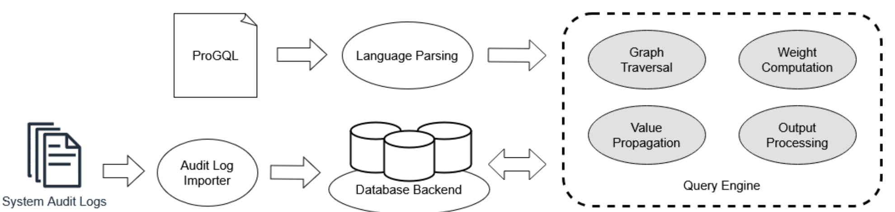
    </a>
    

      
ProGQL gives analysts a graph query language for expressing attack investigation tasks over system provenance. Its incremental query engine searches audit-log dependencies across database backends without loading the entire provenance graph into memory.

      
<a href="https://github.com/ProGQL/ProGQL">Code</a> · <a href="/papers/progql_icde2026.pdf">Paper (ICDE’26)</a>

    

  

</section>

<section class="software-project" id="psyscam" aria-labelledby="psyscam-title">
  <h2 id="psyscam-title">PsyScam</h2>
  

    <a class="software-project__figure" href="/images/software/psyscam.png" aria-label="View full-size PsyScam figure">
      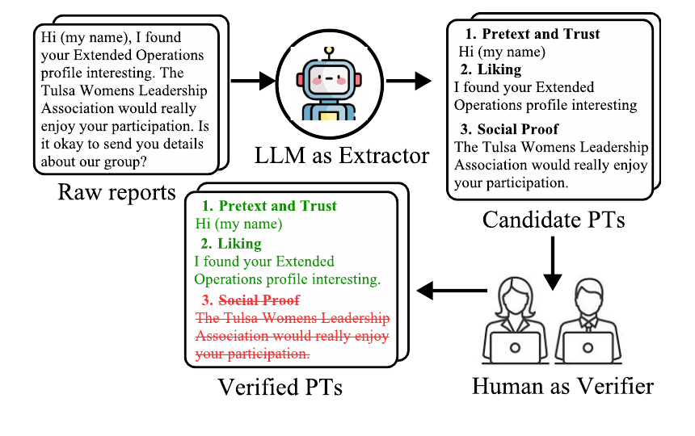
    </a>
    

      
PsyScam makes the psychological techniques behind real-world scams explicit through a theory-grounded benchmark. Its human–LLM annotation workflow pairs automated extraction with human verification to support studying and detecting persuasive scam tactics.

      
<a href="https://github.com/KiteFlyKid/PsyScam">Code</a> · <a href="https://anonymous.4open.science/r/PsyScam-66E4/README.md">Open Science</a> · <a href="/papers/psyscam_emnlp_2025.pdf">Paper (EMNLP’25)</a>

    

  

</section>

<section class="software-project" id="appbds" aria-labelledby="appbds-title">
  <h2 id="appbds-title">AppBDS</h2>
  

    <a class="software-project__figure" href="/images/software/appbds.png" aria-label="View full-size AppBDS figure">
      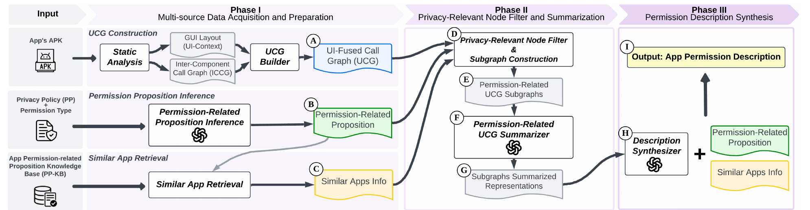
    </a>
    

      
AppBDS explains why an Android app uses sensitive permissions by combining program behavior, interface context, privacy policies, and knowledge from similar apps. It builds UI-fused call graphs and uses an LLM to synthesize descriptions grounded in the app’s permission-related behavior.

      
<a href="https://github.com/AppBDS/AppBDS">Code</a> · <a href="/papers/appbds-ase2025.pdf">Paper (ASE’25)</a>

    

  

</section>

<section class="software-project" id="adgpe" aria-labelledby="adgpe-title">
  <h2 id="adgpe-title">AdGPE</h2>
  

    <a class="software-project__figure" href="/images/software/adgpe.png" aria-label="View full-size AdGPE figure">
      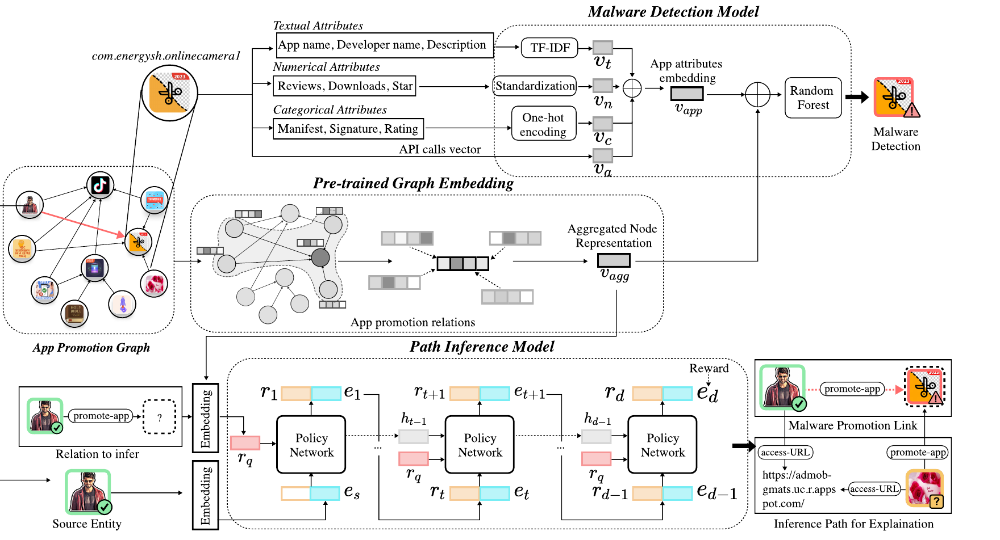
    </a>
    

      
AdGPE follows in-app advertisements to build a graph of how apps promote one another. Graph-based learning detects promoted malware, while path inference explains the promotion channels that lead users to malicious apps.

      
<a href="https://github.com/AppPromotionAdsResearch/AdGPE">Code</a> · <a href="/papers/adgpe_ndss2025.pdf">Paper (NDSS’25)</a>

    

  

</section>

<section class="software-project" id="ctikg" aria-labelledby="ctikg-title">
  <h2 id="ctikg-title">CTIKG</h2>
  

    <a class="software-project__figure" href="/images/software/ctikg.png" aria-label="View full-size CTIKG figure">
      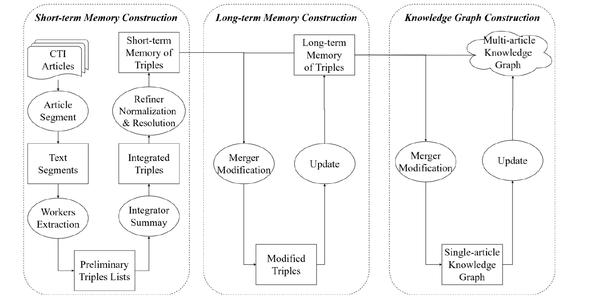
    </a>
    

      
CTIKG turns long, unstructured cyber threat intelligence reports into connected knowledge graphs. Coordinated LLM agents extract, refine, and merge facts using short- and long-term memory, linking threat knowledge within and across reports.

      
<a href="https://github.com/ctikgresearch/GTIKGResearch">Code</a> · <a href="/papers/ctikg-colm2024.pdf">Paper (COLM’24)</a>

    

  

</section>

<section class="software-project" id="isyn" aria-labelledby="isyn-title">
  <h2 id="isyn-title">iSyn</h2>
  

    
    

      
iSyn translates legal financial agreements into executable smart contracts through an intermediate representation called SmartIR. Intent classification and slot filling recover contractual obligations, which guide contract synthesis and validation.

      
<a href="https://github.com/smartcontractsyn/iSyn">Code</a> · <a href="/papers/iSyn_issta.pdf">Paper (ISSTA’23)</a>

    

  

</section>

<section class="software-project" id="vfix" aria-labelledby="vfix-title">
  <h2 id="vfix-title">vFix</h2>
  

    <a class="software-project__figure" href="/images/vfix-figure4.png" aria-label="View full-size vFix figure">
      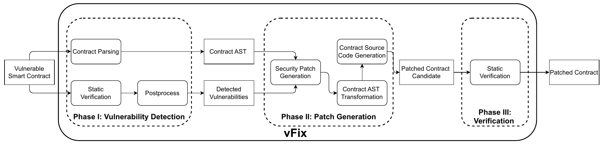
    </a>
    

      
vFix repairs smart contract vulnerabilities using reusable fix patterns and program analysis. Dependency and pointer analysis adapt the patterns to each contract, and verification checks candidate patches for vulnerability removal and preservation of expected behavior.

      
<a href="https://github.com/vfixresearch/vFix">Code</a> · <a href="/papers/vFix_ICSME2024.pdf">Paper (ICSME’24)</a>

    

  

</section>

<section class="software-project" id="describectx" aria-labelledby="describectx-title">
  <h2 id="describectx-title">DescribeCtx</h2>
  

    <a class="software-project__figure" href="/images/software/describectx.png" aria-label="View full-size DescribeCtx figure">
      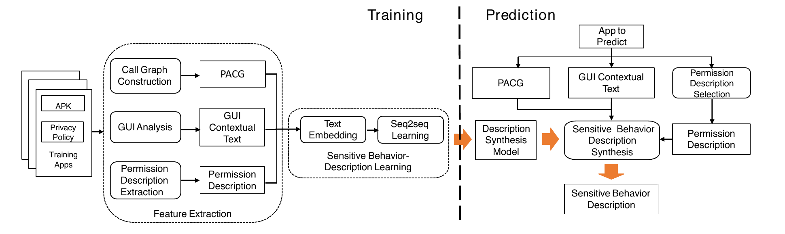
    </a>
    

      
DescribeCtx generates app-specific explanations of sensitive behaviors instead of relying on generic permission labels. It combines call-graph analysis, interface text, and privacy-policy information to learn descriptions that reflect the context in which a behavior occurs.

      
<a href="https://github.com/DescribeCTX/DescribeCTX">Code</a> · <a href="/papers/describectx_cr.pdf">Paper (ICSE’22)</a>

    

  

</section>

<section class="software-project" id="promal" aria-labelledby="promal-title">
  <h2 id="promal-title">ProMal</h2>
  

    <a class="software-project__figure" href="/images/software/promal.png" aria-label="View full-size ProMal figure">
      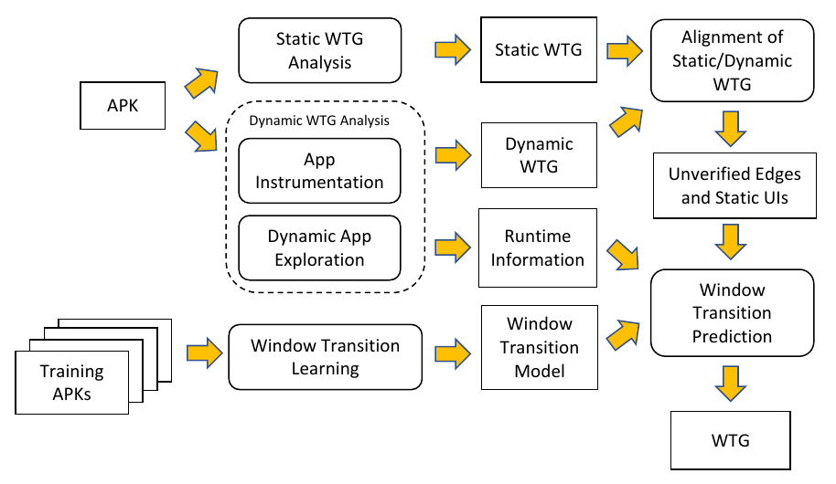
    </a>
    

      
ProMal builds more precise Android window transition graphs by combining static analysis, runtime exploration, and machine learning. It aligns static and dynamic evidence, then predicts feasible transitions that exploration alone may miss.

      
<a href="https://github.com/promal-android/Promal">Code</a> · <a href="/papers/promal_icse_cr.pdf">Paper (ICSE’22)</a>

    

  

</section>

<section class="software-project" id="depcomm" aria-labelledby="depcomm-title">
  <h2 id="depcomm-title">DepComm</h2>
  

    <a class="software-project__figure" href="/images/software/depcomm.png" aria-label="View full-size DepComm figure">
      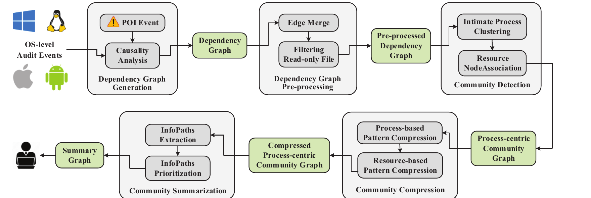
    </a>
    

      
DepComm makes large system provenance graphs easier to investigate by organizing processes and resources into communities. It compresses repetitive dependencies and extracts informative paths between communities to preserve the context needed to trace an attack.

      
<a href="https://github.com/ieeesp2021sub/depcomm">Code</a> · <a href="/papers/depcomm-ieeesp2022.pdf">Paper (IEEE S&amp;P’22)</a>

    

  

</section>

<section class="software-project" id="depimpact" aria-labelledby="depimpact-title">
  <h2 id="depimpact-title">DepImpact</h2>
  

    
    

      
DepImpact helps investigators isolate the critical parts of an attack from a large dependency graph. It back-propagates dependency impact to rank likely entry points, then uses forward causality analysis to recover a focused attack subgraph.

      
<a href="https://github.com/usenixsub/DepImpact">Code</a> · <a href="/papers/sec22summer_fang.pdf">Paper (USENIX Security’22)</a>

    

  

</section>

<section class="software-project" id="champ" aria-labelledby="champ-title">
  <h2 id="champ-title">CHAMP (UBCFinder)</h2>
  

    <a class="software-project__figure" href="/images/software/champ.png" aria-label="View full-size CHAMP (UBCFinder) figure">
      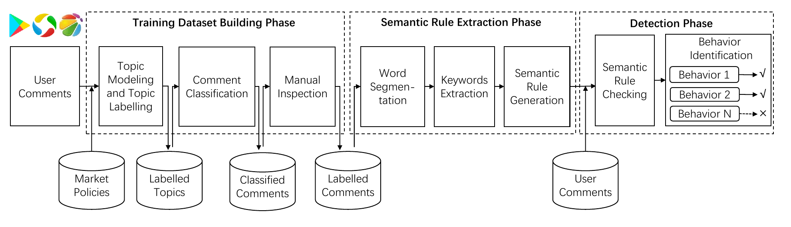
    </a>
    

      
CHAMP uncovers undesired app behaviors reported in user comments by connecting those reports to app-market policies. Topic modeling and semantic rule extraction turn user feedback into actionable signals for identifying policy-related behavior concerns.

      
<a href="https://github.com/UBCFinder/UBCFinder">Code</a> · <a href="/papers/champ_icse2021_cr-submit3.pdf">Paper (ICSE’21)</a>

    

  

</section>

<section class="software-project" id="webevo" aria-labelledby="webevo-title">
  <h2 id="webevo-title">WebEvo</h2>
  

    
    

      
WebEvo identifies meaningful structural changes as web applications evolve. It combines historical DOM analysis with element-level visual comparison to distinguish changes to interface structure from routine content updates.

      
<a href="https://github.com/webevoexp/webevo">Code</a> · <a href="/papers/webevo-cr.pdf">Paper (ISSTA’21)</a>

    

  

</section>

<section class="software-project" id="deepintent" aria-labelledby="deepintent-title">
  <h2 id="deepintent-title">DeepIntent</h2>
  

    
    

      
DeepIntent checks whether an Android app’s sensitive behaviors match the intentions conveyed by its icons and interface text. It learns icon–behavior relationships from apps and flags unusual permission use that conflicts with those visual and textual cues.

      
<a href="https://github.com/deepintent-ccs/DeepIntent/">Code</a> · <a href="/papers/deepintent-optimize.pdf">Paper (CCS’19)</a>

    

  

</section>

<section class="software-project" id="hyperservice" aria-labelledby="hyperservice-title">
  <h2 id="hyperservice-title">HyperService</h2>
  

    <a class="software-project__figure" href="/images/software/hyperservice.png" aria-label="View full-size HyperService figure">
      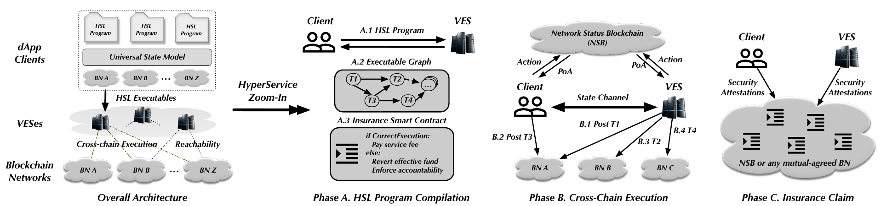
    </a>
    

      
HyperService enables applications to program coordinated actions across heterogeneous blockchains. A unified programming model compiles cross-chain workflows, while a cryptographic protocol coordinates their execution and handles failures.

      
<a href="https://github.com/HyperService-Consortium">Code</a> · <a href="/papers/hyperservice.pdf">Paper (CCS’19)</a>

    

  

</section>

<section class="software-project" id="appcontext" aria-labelledby="appcontext-title">
  <h2 id="appcontext-title">AppContext</h2>
  

    
    

      
AppContext distinguishes malicious and benign uses of sensitive Android operations by examining the events and conditions that trigger them. Its context analysis captures how a behavior is reached, helping identify suspicious behavior even when benign apps use the same permissions.

      
<a href="https://sites.google.com/site/asergrp/projects/appcontext">Project website</a> · <a href="/papers/appcontext-icse2015.pdf">Paper (ICSE’15)</a>

    

  

</section>

<section class="software-project" id="whyper" aria-labelledby="whyper-title">
  <h2 id="whyper-title">WHYPER</h2>
  

    
    

      
WHYPER checks whether an app’s natural-language description explains its requested permissions. It combines language analysis with semantic knowledge from API documentation to connect advertised functionality to sensitive capabilities.

      
<a href="https://sites.google.com/site/whypermission/">Project website</a> · <a href="/papers/whyper-usenix2013.pdf">Paper (USENIX Security’13)</a>

    

  

</section>

<section class="software-project" id="apiinfer" aria-labelledby="apiinfer-title">
  <h2 id="apiinfer-title">API Specification Inference</h2>
  

    
    

      
This approach extracts method specifications from natural-language API documentation. It translates documented usage constraints into logical expressions and code contracts that can support automated checking of API use.

      
<a href="https://research.csc.ncsu.edu/ase/projects/pint/">Project website</a> · <a href="/papers/xusheng-icse2012.pdf">Paper (ICSE’12)</a>

    

  

</section>

<section class="software-project" id="covana" aria-labelledby="covana-title">
  <h2 id="covana-title">Covana</h2>
  

    
    

      
Covana identifies the external calls and object-creation problems that prevent dynamic symbolic execution from reaching more code. Runtime evidence and data-dependency analysis focus developer assistance on the obstacles that actually limit structural test coverage.

      
<a href="http://pexase.codeplex.com/wikipage?title=Covana&amp;referringTitle=Home">Project website</a> · <a href="/papers/covana-icse2011.pdf">Paper (ICSE’11)</a>

    

  

</section>
