

Research software and resources, with figures from the corresponding papers. Select a figure to view it at full size.

<section aria-labelledby="progql-title" class="software-project" id="progql">
<h2 id="progql-title">ProGQL</h2>

ProGQL gives analysts a graph query language for expressing attack investigation tasks over system provenance. Its incremental query engine searches audit-log dependencies across database backends without loading the entire provenance graph into memory.

<a href="https://github.com/ProGQL/ProGQL">Code</a> · <a href="/papers/progql_icde2026.pdf">Paper (ICDE’26)</a>

<figure><a aria-label="View full-size example for ProGQL" href="/images/software/progql-example.png">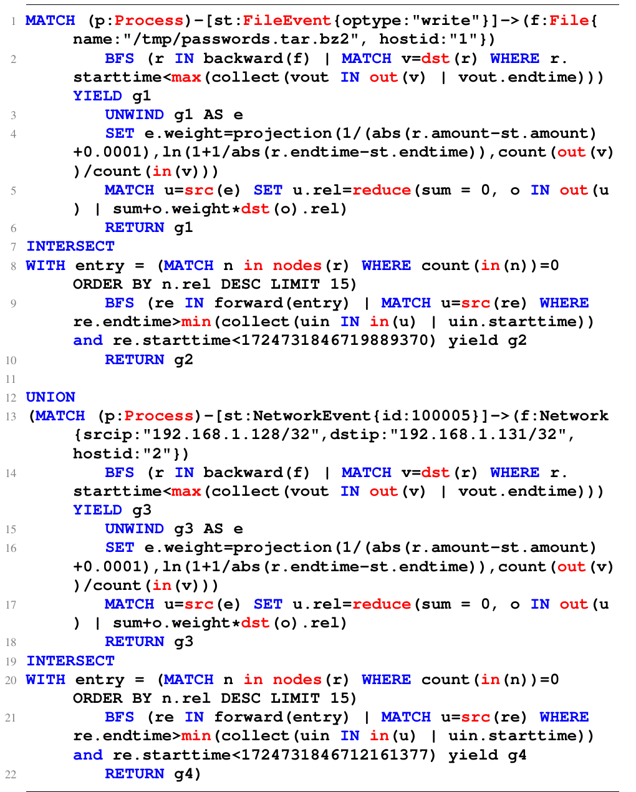</a><figcaption>A password-crack investigation expressed as a ProGQL query. <a href="/papers/progql_icde2026.pdf">Query 1 in the paper</a></figcaption></figure>
</section>
<section aria-labelledby="psyscam-title" class="software-project" id="psyscam">
<h2 id="psyscam-title">PsyScam</h2>

PsyScam makes the psychological techniques behind real-world scams explicit through a theory-grounded benchmark. Its human–LLM annotation workflow pairs automated extraction with human verification to support studying and detecting persuasive scam tactics.

<a href="https://github.com/KiteFlyKid/PsyScam">Code</a> · <a href="https://anonymous.4open.science/r/PsyScam-66E4/README.md">Open Science</a> · <a href="/papers/psyscam_emnlp_2025.pdf">Paper (EMNLP’25)</a>

<figure><a aria-label="View full-size example for PsyScam" href="/images/software/psyscam-example.png">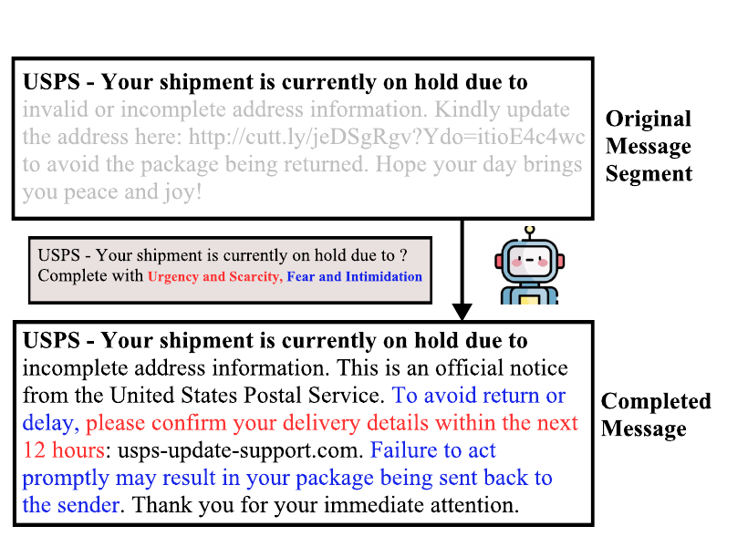</a><figcaption>A scam-completion case study shows how a model adds specified psychological techniques; colored text marks the techniques. <a href="/papers/psyscam_emnlp_2025.pdf">Figure 6 in the paper</a></figcaption></figure>
</section>
<section aria-labelledby="appbds-title" class="software-project" id="appbds">
<h2 id="appbds-title">AppBDS</h2>

AppBDS explains why an Android app uses sensitive permissions by combining program behavior, interface context, privacy policies, and knowledge from similar apps. It builds UI-fused call graphs and uses an LLM to synthesize descriptions grounded in the app’s permission-related behavior.

<a href="https://github.com/AppBDS/AppBDS">Code</a> · <a href="/papers/appbds-ase2025.pdf">Paper (ASE’25)</a>

<figure><a aria-label="View full-size example for AppBDS" href="/images/software/appbds-example.png">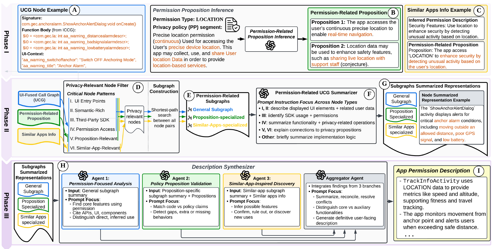</a><figcaption>A MarineApp example: program and policy evidence lead to an app-specific location-permission explanation. <a href="/papers/appbds-ase2025.pdf">Figure 2 in the paper</a></figcaption></figure>
</section>
<section aria-labelledby="adgpe-title" class="software-project" id="adgpe">
<h2 id="adgpe-title">AdGPE</h2>

AdGPE follows in-app advertisements to build a graph of how apps promote one another. Graph-based learning detects promoted malware, while path inference explains the promotion channels that lead users to malicious apps.

<a href="https://github.com/AppPromotionAdsResearch/AdGPE">Code</a> · <a href="/papers/adgpe_ndss2025.pdf">Paper (NDSS’25)</a>

<figure><a aria-label="View full-size example for AdGPE" href="/images/software/adgpe-example.png">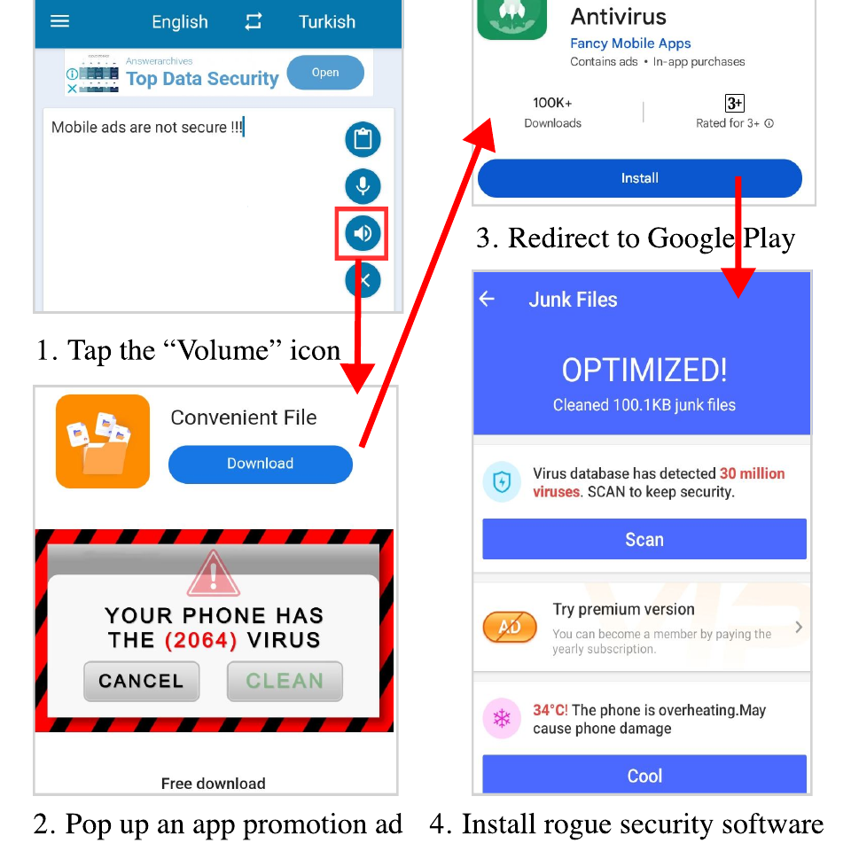</a><figcaption>A mobile promotion ad leads from a benign app to rogue security software. <a href="/papers/adgpe_ndss2025.pdf">Figure 1 in the paper</a></figcaption></figure>
</section>
<section aria-labelledby="ctikg-title" class="software-project" id="ctikg">
<h2 id="ctikg-title">CTIKG</h2>

CTIKG turns long, unstructured cyber threat intelligence reports into connected knowledge graphs. Coordinated LLM agents extract, refine, and merge facts using short- and long-term memory, linking threat knowledge within and across reports.

<a href="https://github.com/ctikgresearch/GTIKGResearch">Code</a> · <a href="/papers/ctikg-colm2024.pdf">Paper (COLM’24)</a>

<figure><a aria-label="View full-size example for CTIKG" href="/images/software/ctikg-example.png">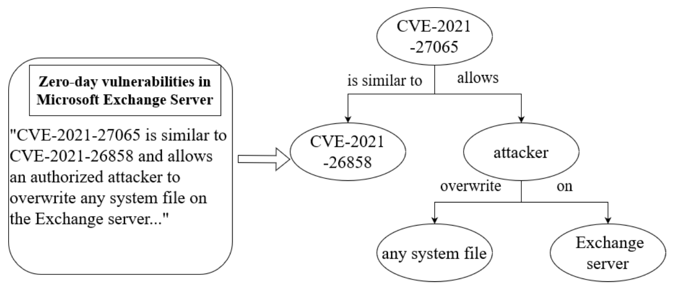</a><figcaption>A CTI report becomes a knowledge graph connecting vulnerabilities, attacker capabilities, and affected systems. <a href="/papers/ctikg-colm2024.pdf">Figure 11 in the paper</a></figcaption></figure>
</section>
<section aria-labelledby="isyn-title" class="software-project" id="isyn">
<h2 id="isyn-title">iSyn</h2>

<a aria-label="View full-size iSyn figure" class="software-project__figure" href="/images/software/isyn.png">
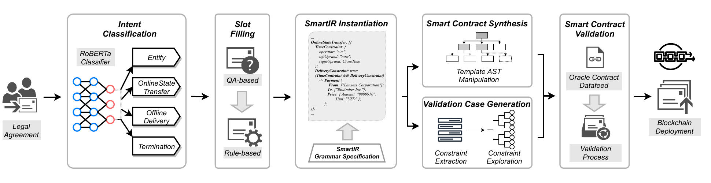
</a>

iSyn translates legal financial agreements into executable smart contracts through an intermediate representation called SmartIR. Intent classification and slot filling recover contractual obligations, which guide contract synthesis and validation.

<a href="https://github.com/smartcontractsyn/iSyn">Code</a> · <a href="/papers/iSyn_issta.pdf">Paper (ISSTA’23)</a>

<figure><a aria-label="View full-size example for iSyn" href="/images/software/isyn-example.png">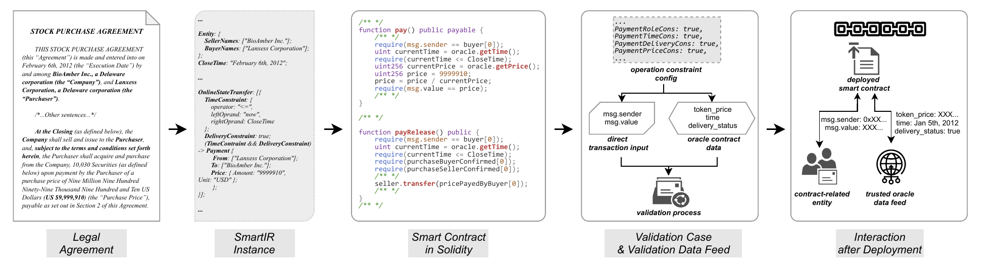</a><figcaption>A financial agreement is translated into SmartIR and Solidity, then validated and deployed. <a href="/papers/iSyn_issta.pdf">Figure 2 in the paper</a></figcaption></figure>
</section>
<section aria-labelledby="vfix-title" class="software-project" id="vfix">
<h2 id="vfix-title">vFix</h2>

vFix repairs smart contract vulnerabilities using reusable fix patterns and program analysis. Dependency and pointer analysis adapt the patterns to each contract, and verification checks candidate patches for vulnerability removal and preservation of expected behavior.

<a href="https://github.com/vfixresearch/vFix">Code</a> · <a href="/papers/vFix_ICSME2024.pdf">Paper (ICSME’24)</a>

<figure><a aria-label="View full-size example for vFix" href="/images/software/vfix-example.png">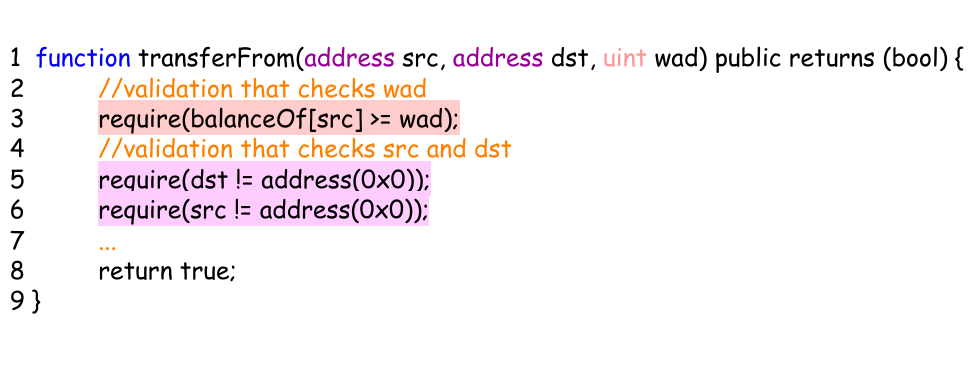</a><figcaption>A repaired transferFrom function adds checks for the transfer amount and addresses. <a href="/papers/vFix_ICSME2024.pdf">Figure 6 in the paper</a></figcaption></figure><figure><a aria-label="View full-size example for vFix" href="/images/software/vfix-lockedether-example.png">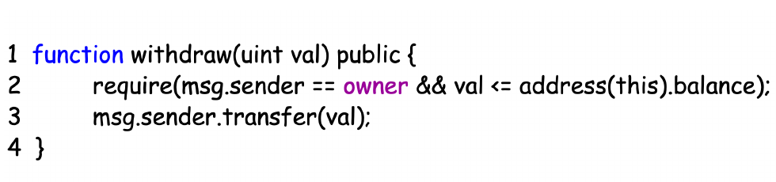</a><figcaption>A generated withdraw function repairs LockedEther by allowing the owner to retrieve the contract balance. <a href="/papers/vFix_ICSME2024.pdf">Figure 7 in the paper</a></figcaption></figure>
</section>
<section aria-labelledby="describectx-title" class="software-project" id="describectx">
<h2 id="describectx-title">DescribeCtx</h2>

DescribeCtx generates app-specific explanations of sensitive behaviors instead of relying on generic permission labels. It combines call-graph analysis, interface text, and privacy-policy information to learn descriptions that reflect the context in which a behavior occurs.

<a href="https://github.com/DescribeCTX/DescribeCTX">Code</a> · <a href="/papers/describectx_cr.pdf">Paper (ICSE’22)</a>

<figure><a aria-label="View full-size example for DescribeCtx" href="/images/software/describectx-example.png">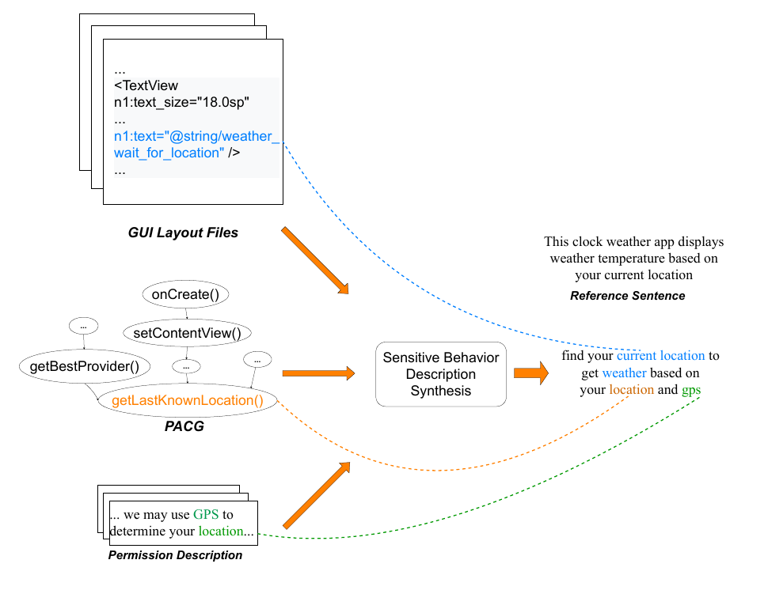</a><figcaption>GUI layout, a permission-annotated call graph, and permission descriptions jointly generate a location-use explanation. <a href="/papers/describectx_cr.pdf">Figure 2 in the paper</a></figcaption></figure>
</section>
<section aria-labelledby="promal-title" class="software-project" id="promal">
<h2 id="promal-title">ProMal</h2>

ProMal builds more precise Android window transition graphs by combining static analysis, runtime exploration, and machine learning. It aligns static and dynamic evidence, then predicts feasible transitions that exploration alone may miss.

<a href="https://github.com/promal-android/Promal">Code</a> · <a href="/papers/promal_icse_cr.pdf">Paper (ICSE’22)</a>

<figure><a aria-label="View full-size example for ProMal" href="/images/software/promal-example.png">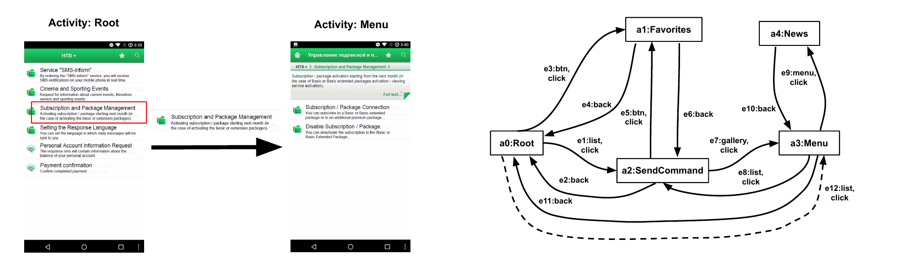</a><figcaption>Example Android screens and the partial window transition graph describing their navigation. <a href="/papers/promal_icse_cr.pdf">Figures 1–2 in the paper</a></figcaption></figure>
</section>
<section aria-labelledby="depcomm-title" class="software-project" id="depcomm">
<h2 id="depcomm-title">DepComm</h2>

DepComm makes large system provenance graphs easier to investigate by organizing processes and resources into communities. It compresses repetitive dependencies and extracts informative paths between communities to preserve the context needed to trace an attack.

<a href="https://github.com/ieeesp2021sub/depcomm">Code</a> · <a href="/papers/depcomm-ieeesp2022.pdf">Paper (IEEE S&amp;P’22)</a>

<figure><a aria-label="View full-size example for DepComm" href="/images/software/depcomm-example.png">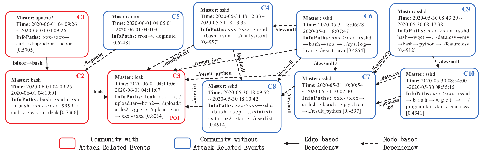</a><figcaption>A data-exfiltration investigation summarized into ten process communities and their dependencies. <a href="/papers/depcomm-ieeesp2022.pdf">Figure 2 in the paper</a></figcaption></figure>
</section>
<section aria-labelledby="depimpact-title" class="software-project" id="depimpact">
<h2 id="depimpact-title">DepImpact</h2>

<a aria-label="View full-size DepImpact figure" class="software-project__figure" href="/images/software/depimpact.png">
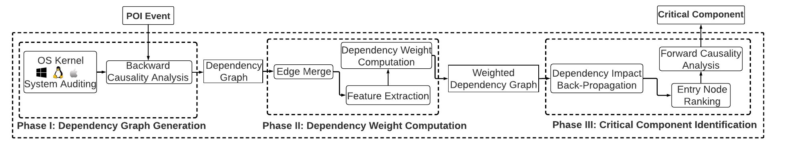
</a>

DepImpact helps investigators isolate the critical parts of an attack from a large dependency graph. It back-propagates dependency impact to rank likely entry points, then uses forward causality analysis to recover a focused attack subgraph.

<a href="https://github.com/usenixsub/DepImpact">Code</a> · <a href="/papers/sec22summer_fang.pdf">Paper (USENIX Security’22)</a>

<figure><a aria-label="View full-size example for DepImpact" href="/images/software/depimpact-example.png">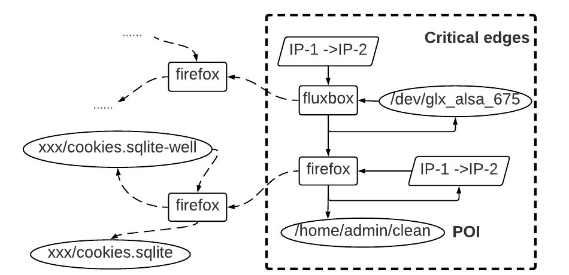</a><figcaption>The critical attack component recovered for a Theia case isolates the causal path to the point of interest. <a href="/papers/sec22summer_fang.pdf">Figure 3 in the paper</a></figcaption></figure>
</section>
<section aria-labelledby="champ-title" class="software-project" id="champ">
<h2 id="champ-title">CHAMP (UBCFinder)</h2>

CHAMP uncovers undesired app behaviors reported in user comments by connecting those reports to app-market policies. Topic modeling and semantic rule extraction turn user feedback into actionable signals for identifying policy-related behavior concerns.

<a href="https://github.com/UBCFinder/UBCFinder">Code</a> · <a href="/papers/champ_icse2021_cr-submit3.pdf">Paper (ICSE’21)</a>

<figure><a aria-label="View full-size example for CHAMP (UBCFinder)" href="/images/software/champ-example.png">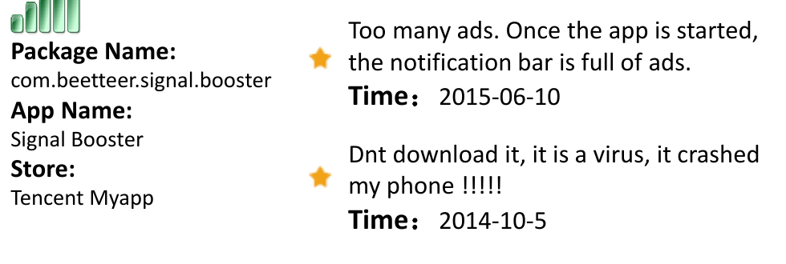</a><figcaption>A concrete undesired-behavior example: user comments report intrusive ads and suspected malware. <a href="/papers/champ_icse2021_cr-submit3.pdf">Figure 1 in the paper</a></figcaption></figure>
</section>
<section aria-labelledby="webevo-title" class="software-project" id="webevo">
<h2 id="webevo-title">WebEvo</h2>

<a aria-label="View full-size WebEvo figure" class="software-project__figure" href="/images/software/webevo.png">
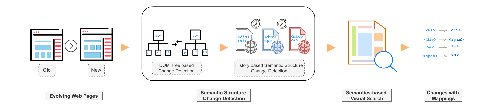
</a>

WebEvo identifies meaningful structural changes as web applications evolve. It combines historical DOM analysis with element-level visual comparison to distinguish changes to interface structure from routine content updates.

<a href="https://github.com/webevoexp/webevo">Code</a> · <a href="/papers/webevo-cr.pdf">Paper (ISSTA’21)</a>

<figure><a aria-label="View full-size example for WebEvo" href="/images/software/webevo-example.png">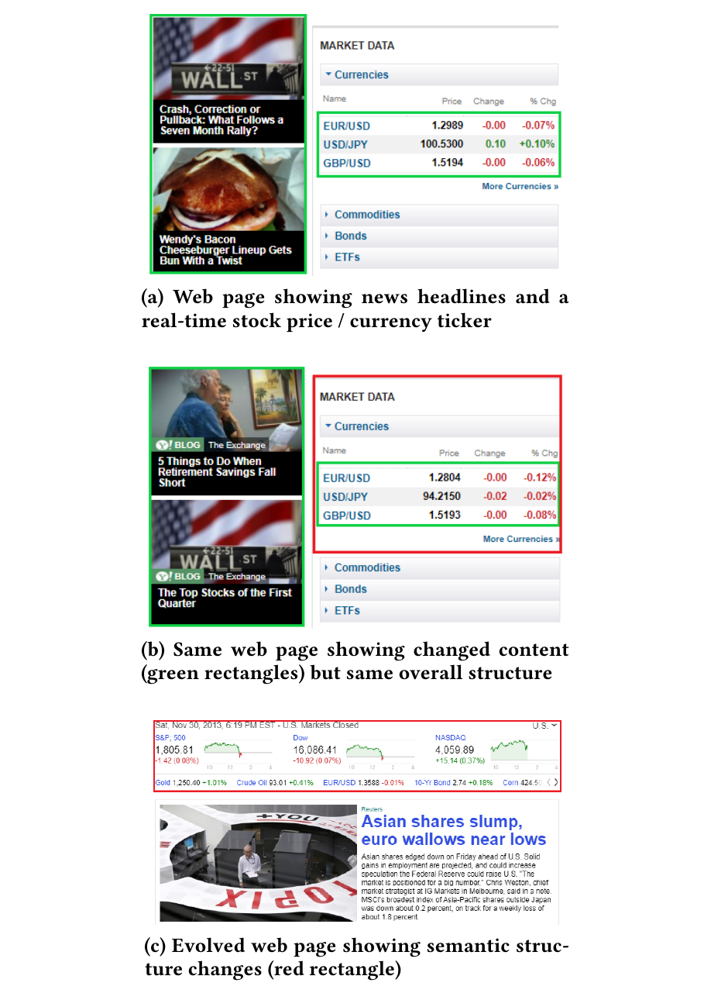</a><figcaption>Web-page comparisons distinguish routine content updates from semantic structure changes highlighted in red. <a href="/papers/webevo-cr.pdf">Figure 4 in the paper</a></figcaption></figure>
</section>
<section aria-labelledby="deepintent-title" class="software-project" id="deepintent">
<h2 id="deepintent-title">DeepIntent</h2>

<a aria-label="View full-size DeepIntent figure" class="software-project__figure" href="/images/software/deepintent.png">
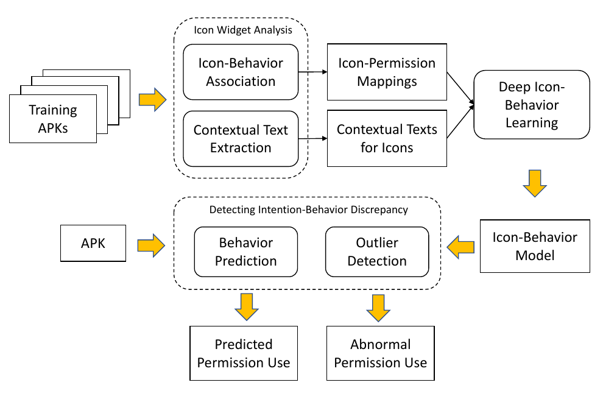
</a>

DeepIntent checks whether an Android app’s sensitive behaviors match the intentions conveyed by its icons and interface text. It learns icon–behavior relationships from apps and flags unusual permission use that conflicts with those visual and textual cues.

<a href="https://github.com/deepintent-ccs/DeepIntent/">Code</a> · <a href="/papers/deepintent-optimize.pdf">Paper (CCS’19)</a>

<figure><a aria-label="View full-size example for DeepIntent" href="/images/software/deepintent-example.png">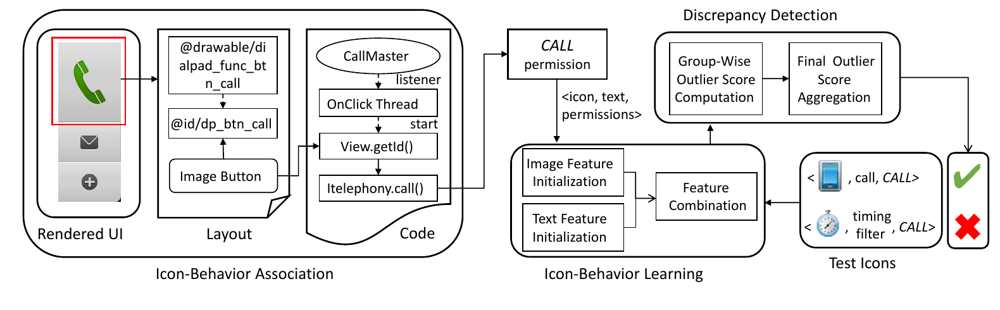</a><figcaption>An icon–behavior example detects a timing-filter button that unexpectedly uses the CALL permission. <a href="/papers/deepintent-optimize.pdf">Figure 2 in the paper</a></figcaption></figure>
</section>
<section aria-labelledby="hyperservice-title" class="software-project" id="hyperservice">
<h2 id="hyperservice-title">HyperService</h2>

HyperService enables applications to program coordinated actions across heterogeneous blockchains. A unified programming model compiles cross-chain workflows, while a cryptographic protocol coordinates their execution and handles failures.

<a href="https://github.com/HyperService-Consortium">Code</a> · <a href="/papers/hyperservice.pdf">Paper (CCS’19)</a>

<figure><a aria-label="View full-size example for HyperService" href="/images/software/hyperservice-example.png">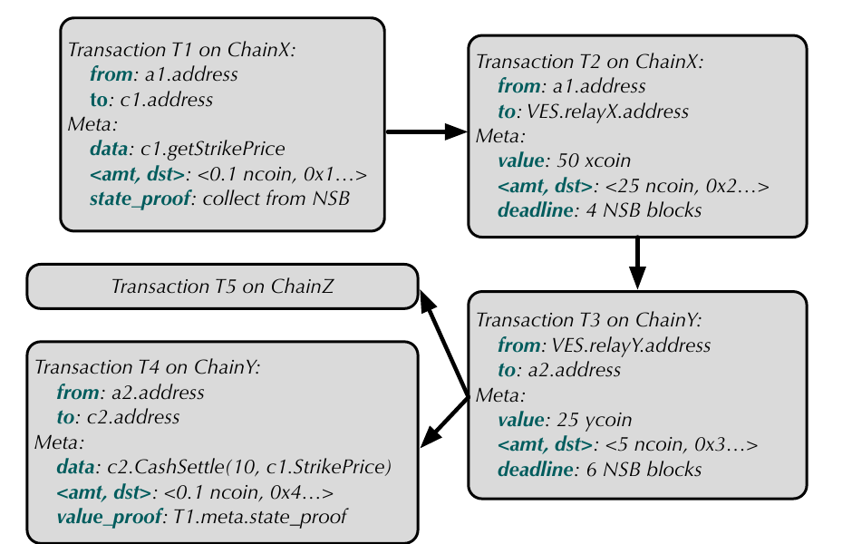</a><figcaption>The generated transaction graph coordinates an option application across multiple blockchains. <a href="/papers/hyperservice.pdf">Figure 4 in the paper</a></figcaption></figure>
</section>
<section aria-labelledby="appcontext-title" class="software-project" id="appcontext">
<h2 id="appcontext-title">AppContext</h2>

<a aria-label="View full-size AppContext figure" class="software-project__figure" href="/images/software/appcontext.png">
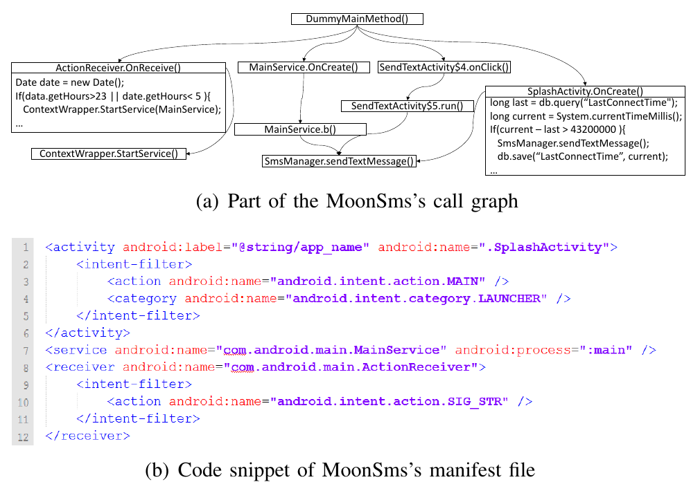
</a>

AppContext distinguishes malicious and benign uses of sensitive Android operations by examining the events and conditions that trigger them. Its context analysis captures how a behavior is reached, helping identify suspicious behavior even when benign apps use the same permissions.

<a href="https://sites.google.com/site/asergrp/projects/appcontext">Project website</a> · <a href="/papers/appcontext-icse2015.pdf">Paper (ICSE’15)</a>

<figure><a aria-label="View full-size example for AppContext" href="/images/software/appcontext-example.png">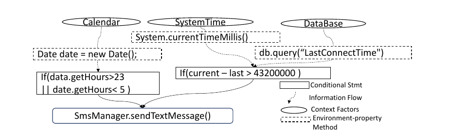</a><figcaption>Extracted MoonSMS context factors show the time and database conditions that trigger an SMS operation. <a href="/papers/appcontext-icse2015.pdf">Figure 4 in the paper</a></figcaption></figure>
</section>
<section aria-labelledby="whyper-title" class="software-project" id="whyper">
<h2 id="whyper-title">WHYPER</h2>

<a aria-label="View full-size WHYPER figure" class="software-project__figure" href="/images/software/whyper.png">
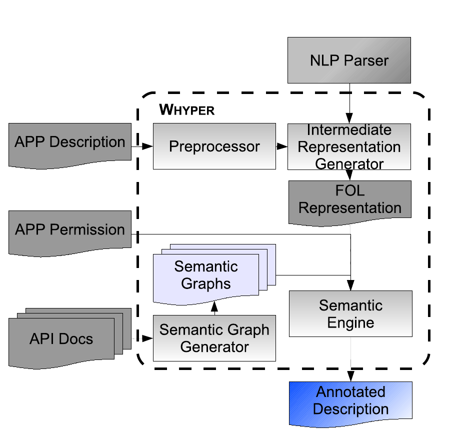
</a>

WHYPER checks whether an app’s natural-language description explains its requested permissions. It combines language analysis with semantic knowledge from API documentation to connect advertised functionality to sensitive capabilities.

<a href="https://sites.google.com/site/whypermission/">Project website</a> · <a href="/papers/whyper-usenix2013.pdf">Paper (USENIX Security’13)</a>

<figure><a aria-label="View full-size example for WHYPER" href="/images/software/whyper-example.png">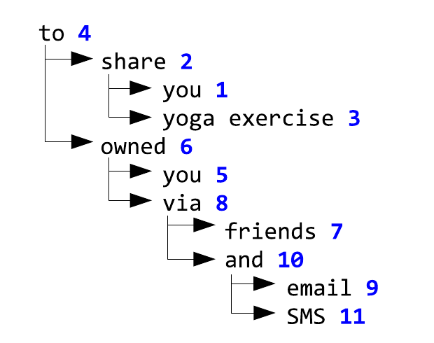</a><figcaption>A description sentence is converted into a logical representation of sharing actions and resources for permission reasoning. <a href="/papers/whyper-usenix2013.pdf">Figure 4 in the paper</a></figcaption></figure>
</section>
<section aria-labelledby="apiinfer-title" class="software-project" id="apiinfer">
<h2 id="apiinfer-title">API Specification Inference</h2>

<a aria-label="View full-size API specification inference figure" class="software-project__figure" href="/images/software/apiinfer.png">
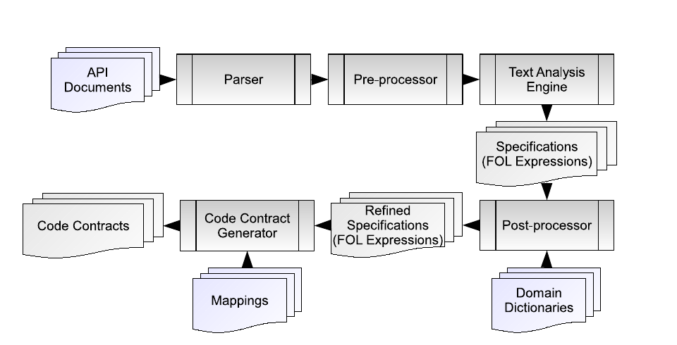
</a>

This approach extracts method specifications from natural-language API documentation. It translates documented usage constraints into logical expressions and code contracts that can support automated checking of API use.

<a href="https://research.csc.ncsu.edu/ase/projects/pint/">Project website</a> · <a href="/papers/xusheng-icse2012.pdf">Paper (ICSE’12)</a>

<figure><a aria-label="View full-size example for API Specification Inference" href="/images/software/apiinfer-example.png">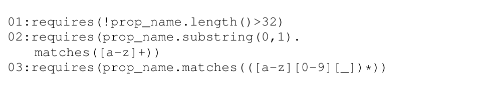</a><figcaption>Inferred requires clauses express API constraints as executable specifications. <a href="/papers/xusheng-icse2012.pdf">Figure 6 in the paper</a></figcaption></figure>
</section>
<section aria-labelledby="covana-title" class="software-project" id="covana">
<h2 id="covana-title">Covana</h2>

<a aria-label="View full-size Covana figure" class="software-project__figure" href="/images/software/covana.png">
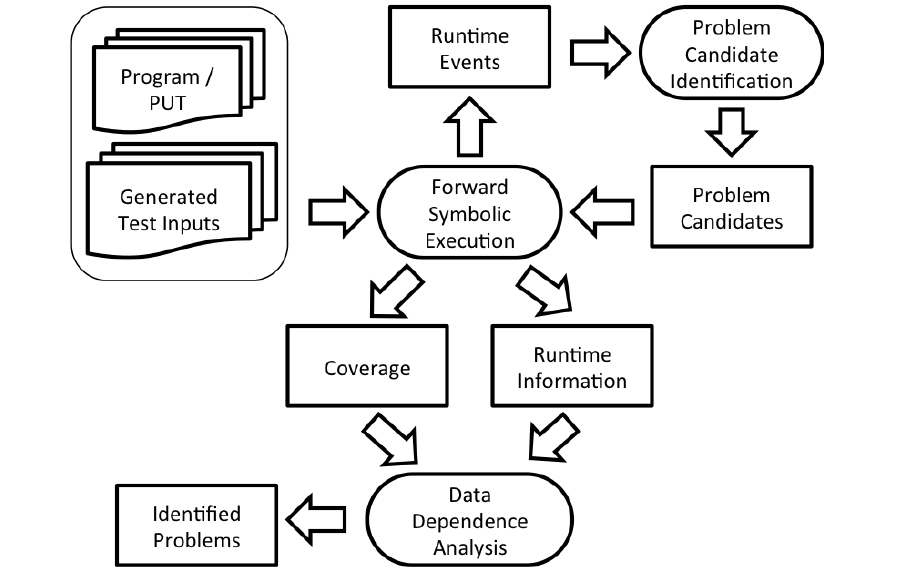
</a>

Covana identifies the external calls and object-creation problems that prevent dynamic symbolic execution from reaching more code. Runtime evidence and data-dependency analysis focus developer assistance on the obstacles that actually limit structural test coverage.

<a href="http://pexase.codeplex.com/wikipage?title=Covana&amp;referringTitle=Home">Project website</a> · <a href="/papers/covana-icse2011.pdf">Paper (ICSE’11)</a>

<figure><a aria-label="View full-size example for Covana" href="/images/software/covana-example.png">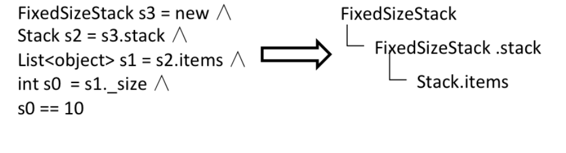</a><figcaption>A worked object-creation analysis maps runtime constraints to the nested fields that prevent test generation. <a href="/papers/covana-icse2011.pdf">Section 4.4.2 in the paper</a></figcaption></figure>
</section>
